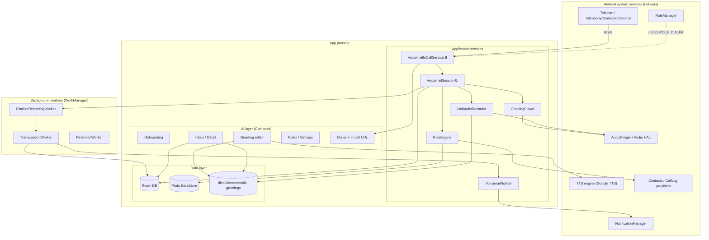
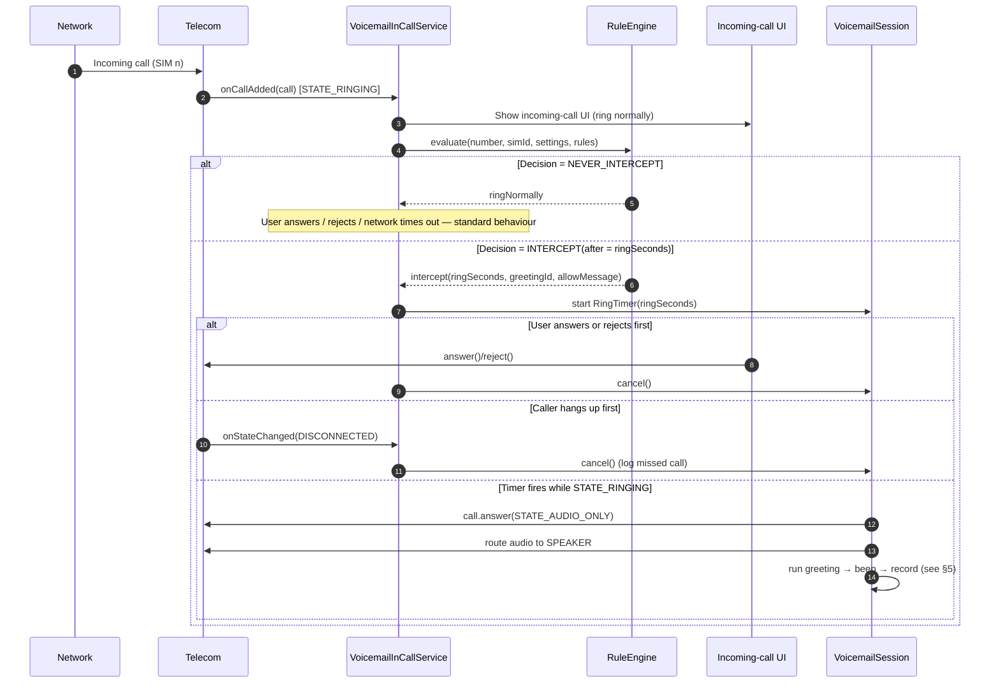
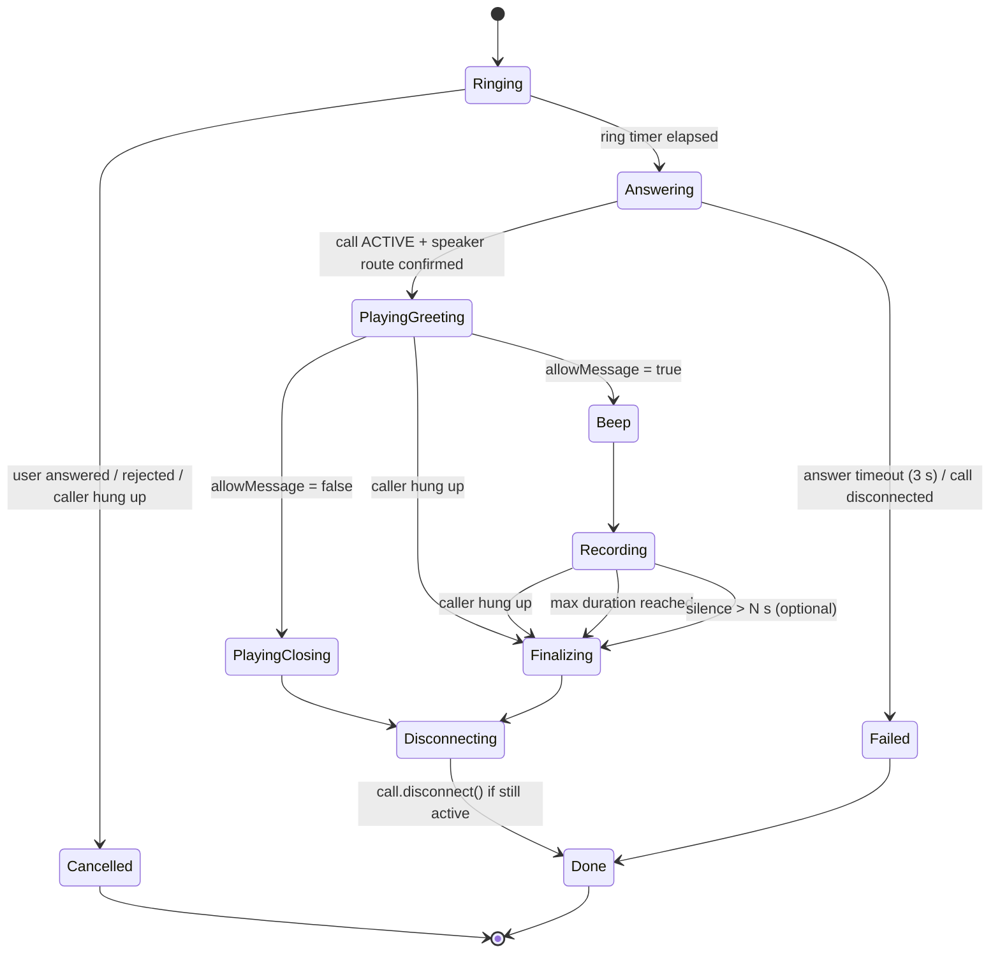
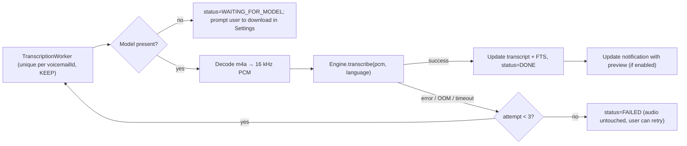
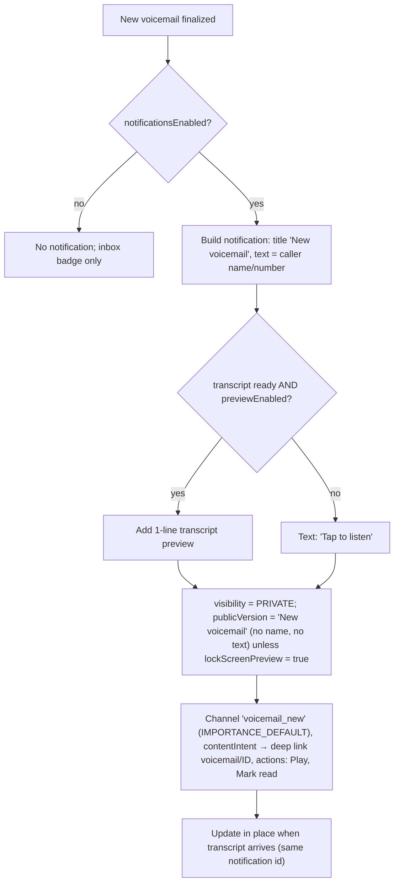
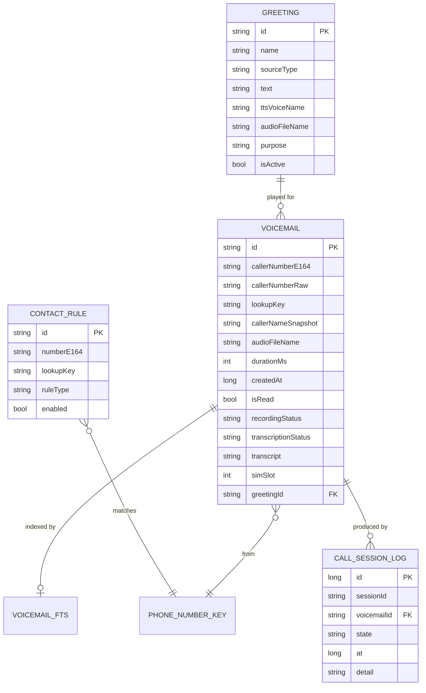

# Architecture

> The telephony layer described here follows the **provisional** [ADR-0001](decisions/ADR-0001-telephony-architecture.md). Every component marked 🔒 is **blocked by the Phase 0 gate** and is not built unless experiments E3 and E4 pass. Everything else (inbox, greetings, TTS, transcription, notifications, rules) is independent of that gate.

## 1. Technology stack

| Concern | Choice | Why |
|---|---|---|
| Language | **Kotlin 2.x** | First-class Android language. Coroutines are a natural fit for call and audio lifecycles. |
| UI | **Jetpack Compose + Material 3** | Modern, declarative, and testable with `compose-ui-test`. Supports dynamic color for a premium native feel. |
| Navigation | **Navigation Compose (type-safe routes)** | Deep links from notifications go straight to a voicemail detail. |
| DI | **Hilt** | The standard choice. Has Android-component injection for `InCallService`, `Worker` and `ViewModel`. Koin is lighter but loses compile-time graph validation. |
| Async | **Coroutines + Flow** | Room, DataStore and Media3 all expose Flow and suspend APIs. |
| Persistence | **Room (KSP)** for voicemails, greetings and rules, with **FTS4** for transcript search | Relational data that needs queries, migrations and observation. |
| Settings | **Proto DataStore** | Typed and atomic. Replaces the proposed `AppSettings` table, since a single-row table is an anti-pattern. |
| Background | **WorkManager** | Transcription, encoding, retention cleanup and orphan sweeping. Retries and constraints survive process death. |
| Playback | **Media3 ExoPlayer** (+ `MediaSession` for lock-screen controls) | Seeking, speed control and audio focus come built in. |
| Capture | **AudioRecord → PCM WAV** (crash-safe) then **MediaCodec AAC → .m4a** | WAV is written incrementally, so a killed process still leaves a valid prefix. AAC shrinks storage about 10×. |
| TTS | Platform **TextToSpeech** | Offline-capable and free. No vendor lock-in. |
| STT | **whisper.cpp** or **Vosk** (decided in E8) behind a `TranscriptionEngine` interface | Offline. The engine can be swapped later. |
| Phone numbers | **libphonenumber** | Normalises numbers to E.164 across `+91` and `0`-prefixed national formats. |
| Testing | JUnit, Robolectric, Turbine, Room in-memory, Compose UI test, UI Automator | See [TESTING_STRATEGY.md](TESTING_STRATEGY.md). |
| Build | Gradle KTS, version catalog, convention plugins (`build-logic/`) | Keeps module build files short. |
| SDK levels | `minSdk 29`, `compileSdk`/`targetSdk 36` | API 29 brings RoleManager and the concurrent-capture policy. 36 is installed locally and meets Play targeting. |

**Rejected:** Flutter and React Native. Every hard part of this app is a platform service (InCallService, AudioRecord, roles), so a cross-platform layer only adds bridges.

## 2. Modules

```
VoiceMail-Android/
├── app/                      Application, MainActivity, NavHost, Hilt entry, manifest merge
├── build-logic/              Gradle convention plugins
├── core/
│   ├── model/                Pure Kotlin: Voicemail, Greeting, ContactRule, enums, PhoneNumber value class
│   ├── common/               Dispatchers, Result types, clock, logging facade
│   ├── database/             Room DB, DAOs, entities, migrations, FTS
│   ├── datastore/            Proto DataStore (AppSettings proto) + repository
│   └── designsystem/         Theme, typography, components (player bar, waveform, empty states)
├── audio/                    GreetingPlayer, CallAudioRecorder, WavWriter, AacEncoder, AudioFileStore
├── telephony/  🔒            VoicemailInCallService, CallRegistry, VoicemailSession state machine,
│                             RingTimer, AudioRouteController, CompatibilitySelfTest
├── transcription/            TranscriptionEngine interface, engine impl (JNI), TranscriptionWorker, model manager
├── contacts/                 ContactLookup, NumberNormalizer, RuleEngine (pure, unit-testable)
├── notifications/            Channels, VoicemailNotifier, privacy redaction
├── feature/
│   ├── onboarding/           Capability explanation, role + permission requests
│   ├── inbox/                Dashboard, inbox list, search/filter, detail + player
│   ├── greeting/             Editor, TTS voice picker, recorder, import
│   ├── rules/                Routing mode, contact rules
│   ├── settings/             General, recording, notification, privacy, storage, diagnostics
│   └── dialer/  🔒           Dial pad (ACTION_DIAL), incoming-call UI, in-call UI — required by ROLE_DIALER
└── spikes/telecom-probe/     Phase 0 throwaway experiment app (not shipped, not depended on)
```

The modules are deliberately coarse. `voicemail` and `settings` from the original brief are folded into `core:*` and `feature:*`, because neither has independent logic. **A module only exists if something consumes it.**

Package root and application ID: `io.github.thisisankit27.voicemail` (with `.<module>` packages, for example `io.github.thisisankit27.voicemail.telephony.session`). It is derived from the GitHub namespace the owner controls; the owner delegated the choice on 2026-11-22. The Phase 0 probe uses `io.github.thisisankit27.voicemail.probe`.

### Responsibilities and dependency rules
- `feature:*` → `core:*`, `audio`, `contacts`, `transcription` (interfaces only). Features never depend on each other.
- `telephony` → `audio`, `contacts`, `core:database`, `core:datastore`, `notifications`. It is the **only** module that touches `android.telecom`.
- `core:model` has no Android dependencies.
- `RuleEngine` in `contacts` is pure Kotlin, so precedence logic is fully unit-tested.

## 3. Application architecture



**Boundaries:**
1. **System services** own the call, the audio routing and the role grants. We only request things from them.
2. **Application services** run while a call exists: the InCallService and session are bound by Telecom for the life of the call. They must not do heavy work.
3. **Background workers** handle everything deferrable (encoding, STT, retention). They are idempotent and retryable.

## 4. Incoming call handling flow 🔒



## 5. VoicemailSession state machine 🔒



Invariants:
- A session only ever acts on **one** `Call` and never touches a call the user is engaged in (call waiting, or a second ringing call while one is active).
- Emergency calls never reach this code. Telecom routes them to the preloaded dialer.
- Every state transition is written to `call_session_log` for diagnostics.

## 6. Voicemail recording flow 🔒

```mermaid
flowchart LR
  A["Recording state entered"] --> B["Create Voicemail row (status=RECORDING, file path reserved)"]
  B --> C["AudioRecord 16 kHz mono PCM"]
  C --> D["WavWriter: stream to vm_UUID.wav, header patched every 1 s"]
  D --> E{"Stop condition"}
  E -->|"hangup / max / silence"| F["Close WAV, set duration"]
  F --> G["status=RECORDED, enqueue FinalizeRecordingWorker"]
  G --> H["Worker: trim leading beep, detect empty (RMS) → status EMPTY or keep"]
  H --> I["Encode AAC .m4a, verify, delete .wav (keep .wav until verified)"]
  I --> J["Enqueue TranscriptionWorker + notify"]
```



Silence detection decides whether the caller actually left a message. Recordings that are pure silence are kept as `EMPTY` entries (shown as "Caller hung up without leaving a message") so nothing is silently lost.

## 7. Transcription pipeline



- The original audio is **never** modified or deleted by transcription.
- The worker runs with `setRequiresBatteryNotLow(true)`. Inference runs on `Dispatchers.Default` with a thread cap.
- The language comes from settings, with `auto` supported when the engine allows it.

## 8. Notification pipeline



## 9. Database relationships

See [DATABASE_DESIGN.md](DATABASE_DESIGN.md) for the full schema.



`PHONE_NUMBER_KEY` is a conceptual join on the E.164 value. It is not a table.

## 10. Process and lifecycle notes
- Telecom keeps `VoicemailInCallService` bound for the whole call, which keeps the process alive.
- Whether starting `AudioRecord` from this context on a locked device is allowed, and whether a `microphone` / `phoneCall` FGS is required, is answered by **E5**. The design assumes a `phoneCall`-type FGS started from the in-call context, which needs `ROLE_DIALER`.
- After a reboot nothing needs to start eagerly. Telecom rebinds the dialer on the next call. `RetentionWorker` is periodic.
- If the process dies mid-recording, the partially written WAV stays valid up to the last header patch. On next start, an orphan sweeper finds rows stuck in `RECORDING` and marks them `RECORDED_PARTIAL`.
