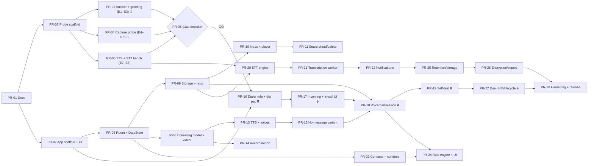

# Development Roadmap

PRs are small and ordered by real dependencies.
- 🔒 means **blocked by the Phase 0 gate** ([ADR-0001](decisions/ADR-0001-telephony-architecture.md)). These PRs are not started until PR-06 records **GO**.
- 📱 means it needs the Moto G60 with a SIM and a second phone.

Phase 1 (PR-07/08) can run **in parallel** with Phase 0, since it has no telephony dependency. Phases 2, 3 and 5 can continue while waiting for a SIM, but the project owner accepts that this work has little value if the gate fails.

---

## Phase 0: Technical feasibility

### PR-01: Planning documentation
- **Objective:** Record the feasibility research, architecture, plans and test procedures.
- **Scope:** `README.md`, `CONTRIBUTING.md` and everything under `docs/`. No code.
- **Implementation:** Markdown and Mermaid only.
- **Dependencies:** None.
- **Acceptance:** Every capability claim carries an evidence label. The device baseline matches the ADB output. No PII appears in the public repo.
- **Testing:** Mermaid renders on GitHub. Links resolve.
- **Risks:** Documentation-based assumptions turn out wrong. Mitigation: they are labelled and re-verified in PR-06.
- **Deliverables:** This document set.

### PR-02: Spike `telecom-probe` scaffold
- **Objective:** A minimal throwaway app that can hold `ROLE_DIALER` / `ROLE_CALL_SCREENING` and log every Telecom callback.
- **Scope:** `spikes/telecom-probe/` with its own Gradle build, kept separate from the product.
  - Contents: role request buttons, an InCallService with minimal incoming and in-call UI (answer, decline, end), an ACTION_DIAL activity (plain number field), a CallScreeningService, and a timeline logger (logcat plus an on-screen list).
- **Implementation:** Kotlin, plain Views or Compose (whichever is faster), with no DI and no DB. minSdk 29, target 36.
- **Dependencies:** PR-01.
- **Acceptance:** E1 passes. The probe obtains and releases the dialer role on the G60 without a SIM, and emergency dialling remains with the system dialer.
- **Testing:** Manual on the G60, plus `cmd role` and `dumpsys telecom` checks.
- **Risks:** An incomplete dialer UI causes RoleManager to revoke the role. Mitigation: implement the required filters exactly as in the official guide.
- **Deliverables:** APK and an E1 result in DEVICE_TESTING.md.

### PR-03: Spike auto-answer and greeting playback (E2, E3) 📱
- **Objective:** Measure ring and answer timing, and whether a greeting played on speaker reaches the caller.
- **Scope:** A configurable ring timer, `answer(STATE_AUDIO_ONLY)`, speaker routing (`setAudioRoute(ROUTE_SPEAKER)` on API < 34, `requestCallEndpointChange` on 34+), and `AudioTrack` playback with a selectable `AudioAttributes` usage and volume.
- **Dependencies:** PR-02, a SIM and Phone B.
- **Acceptance:** E2 and E3 results recorded with pass/fail against the ADR thresholds.
- **Testing:** The E2/E3 protocol in DEVICE_TESTING §4.
- **Risks:** The network forwards or drops the call before the timer fires. Mitigation: measure it, and offer the user documentation on disabling conditional forwarding.
- **Deliverables:** Results table and logs (private).

### PR-04: Spike in-call capture probe (E4, E5, E6) 📱
- **Objective:** Find out whether any non-privileged capture path records the caller.
- **Scope:** `AudioRecord` across 5 sources, an RMS meter, a WAV writer, a locked/unattended scenario, and disconnect handling.
- **Dependencies:** PR-02 (and PR-03 for answering).
- **Acceptance:** Per-source results (silence vs signal, intelligibility) recorded. E5 and E6 recorded.
- **Testing:** The E4–E6 protocol.
- **Risks:** Capture is silenced, which is the likely outcome. That is a valid result, not a failure of the PR.
- **Deliverables:** Results, sample spectrogram screenshots (no voice audio committed).

### PR-05: Spike TTS voices and STT benchmark (E7, E8)
- **Objective:** Choose the offline STT engine. Confirm offline TTS voices exist.
- **Scope:** List voices and render to file. JNI build of whisper.cpp and the Vosk AAR. Benchmark harness that writes a CSV.
- **Dependencies:** PR-02 (shares the probe app). **No SIM needed, so this can run now.**
- **Acceptance:** A table of real-time factor, WER, RAM and size per engine and model on the G60, and a recommended engine.
- **Testing:** 20 fixture clips with reference transcripts.
- **Risks:** Fixture licensing. Use self-recorded clips with consent or public-domain speech.
- **Deliverables:** Benchmark CSV and a recommendation.

### PR-06: Phase 0 results and final ADR-0001
- **Objective:** Make the go/no-go decision.
- **Scope:** Fill in the *Actual* columns, re-verify every [DOC-ASSUMPTION] that the decision relies on (including `STATE_AUDIO_PROCESSING` and `setCallForwarding` visibility), and update the ADR status to Accepted or Rejected. Update the feasibility verdicts.
- **Dependencies:** PR-03, PR-04, PR-05.
- **Acceptance:** The project owner signs off on the decision in the PR.
- **Deliverables:** Updated docs. A revised roadmap if the gate result is PARTIAL or NO-GO.

## Phase 1: Application foundation

### PR-07: Project scaffold and CI
- **Objective:** A buildable multi-module app skeleton.
- **Scope:**
  - Gradle KTS, version catalog, `build-logic` convention plugins, and the modules from ARCHITECTURE §2 (empty).
  - Compose + Material 3 theme (dynamic colour plus fallback), Navigation with 3 tabs, Hilt.
  - Detekt/ktlint (or Spotless).
  - GitHub Actions: `./gradlew lint testDebugUnitTest assembleDebug` on PRs.
- **Dependencies:** PR-01.
- **Acceptance:** CI is green. The app launches on the G60 and on an API 36 emulator.
- **Testing:** A smoke Compose test (tab navigation).
- **Risks:** AGP/Kotlin/JDK version drift. Mitigation: pin versions in the catalog and use a Gradle toolchain (JDK 17/21).
- **Deliverables:** Skeleton app and CI workflow.

### PR-08: Data foundations
- **Objective:** Room DB v1 and Proto DataStore.
- **Scope:** Entities, DAOs, FTS and the partial index (DATABASE_DESIGN), exported schema, `AppSettings` proto, repositories, seeding of the built-in greetings.
- **Dependencies:** PR-07.
- **Acceptance:** DAO tests pass. Schema JSON is committed. Default settings are readable.
- **Testing:** In-memory Room tests (Robolectric), DataStore tests, enum converter tests.
- **Risks:** Locking in a premature schema. Mitigation: AutoMigration tests from v1 onward.
- **Deliverables:** `core:database` and `core:datastore`.

## Phase 2: Voicemail management

### PR-09: Audio file store and voicemail repository
- **Scope:** `AudioFileStore` (paths, atomic creates, deletes), `WavWriter` with periodic header patching, AAC encoder, `FinalizeRecordingWorker`, orphan sweeper, `VoicemailRepository`.
- **Dependencies:** PR-08.
- **Acceptance:** A recording interrupted halfway leaves a playable WAV. Encoding is verified before the WAV is deleted. The sweeper reconciles files and rows.
- **Testing:** Unit tests (WAV header maths), instrumented encode/decode on the emulator, fault-injection tests.
- **Risks:** MediaCodec quirks per device. Mitigation: a fallback that keeps the WAV.

### PR-10: Inbox, detail and player
- **Scope:** Dashboard header, inbox list, detail screen, Media3 player (seek, speed, route), MediaSession notification. A debug-only "import fixture voicemail" menu.
- **Dependencies:** PR-09.
- **Acceptance:** Fixture voicemails list, open and play with seeking and speed changes. Empty states follow the spec.
- **Testing:** Compose UI tests with a fake repository, and player tests with a test-renderer clock.

### PR-11: Search, filters, read state and delete
- **Scope:** FTS query, filter chips, swipe actions, multi-select, soft delete with undo, hard-delete worker.
- **Dependencies:** PR-10.
- **Acceptance:** Search finds transcript words. Delete removes the row and the file after the undo window.
- **Testing:** DAO FTS tests and UI tests.

## Phase 3: Greeting management

### PR-12: Greeting model and editor shell
- **Scope:** Greeting list per purpose, active selection (partial unique index), text editor with `{name}`, restore default.
- **Dependencies:** PR-08.
- **Acceptance:** Exactly one active greeting per purpose at all times.

### PR-13: TTS rendering and voice selection
- **Scope:** `TtsRenderer` (wrapping TextToSpeech init, `getVoices`, `synthesizeToFile`), voice picker with offline badges, preview, stale-render detection via hash.
- **Dependencies:** PR-12, PR-05 (E7 findings).
- **Acceptance:** Rendering works offline with an offline voice. A missing-voice state is handled.
- **Testing:** Instrumented tests on the G60 and emulator. A fake TTS for unit tests.

### PR-14: Record and import greetings
- **Scope:** In-app greeting recorder with level meter and trim. SAF import, decoding, loudness normalisation (peak/RMS target) and a duration cap.
- **Dependencies:** PR-12, PR-09.
- **Acceptance:** Recorded and imported greetings play at consistent loudness.

### PR-15: Message-disabled greeting variant
- **Scope:** Second-purpose greeting, the `allowMessage` toggle and closing-message template.
- **Dependencies:** PR-13.
- **Acceptance:** The UI clearly shows which greeting plays in each mode.

## Phase 4: Telephony integration 🔒 (GO only)

### PR-16: Dialer role onboarding and dial pad 🔒
- **Scope:** Onboarding step 4, `feature:dialer` dial pad (ACTION_DIAL, `tel:`), placing calls via `TelecomManager.placeCall`, SIM picker, recents from CallLog, revert instructions.
- **Dependencies:** PR-06 (GO), PR-07.
- **Acceptance:** The app can hold ROLE_DIALER without being auto-revoked. Outgoing calls work on both SIMs. Emergency calls are handled by the system dialer.
- **Testing:** 📱 manual, plus UI Automator for the role flow.
- **Risks:** Regression to the user's basic calling. Mitigation: the regression suite in DEVICE_TESTING §5.

### PR-17: Incoming and in-call UI 🔒
- **Scope:** `VoicemailInCallService`, `CallRegistry` (a Flow of calls), full-screen incoming notification, in-call screen (mute, speaker, keypad, hold, swap/merge where capable, Bluetooth routes), call waiting.
- **Dependencies:** PR-16.
- **Acceptance:** Tests 2, 3 and 4 pass. Multi-call scenarios don't crash.
- **Testing:** 📱 plus unit tests on `CallRegistry` with fake `Call` wrappers. `android.telecom.Call` is final, so it is wrapped behind an interface.

### PR-18: VoicemailSession state machine 🔒
- **Scope:** RingTimer, answer, speaker route, greeting playback, beep, recording via PR-09, stop conditions, disconnect, session log, "Take over call", and a `phoneCall` FGS where E5 requires it.
- **Dependencies:** PR-17, PR-09, PR-15.
- **Acceptance:** Tests 1, 9, 10, 11, 12 and 13 pass on the G60.
- **Testing:** A pure-Kotlin state machine with exhaustive transition tests. 📱 end-to-end.
- **Risks:** Race conditions between the user answering and the timer. Mitigation: a single-threaded actor (Channel) and the call state as the source of truth.

### PR-19: Compatibility self-test and troubleshooting 🔒
- **Scope:** The guided self-test (UI_UX §3.12), result persistence, gating of the master switch, diagnostics export.
- **Dependencies:** PR-18.
- **Acceptance:** The master switch cannot be enabled without a *Supported* result. Results survive restart.

## Phase 5: Transcription

### PR-20: Transcription engine module
- **Scope:** `TranscriptionEngine` interface, the chosen engine (JNI/AAR), model download with SHA-256 verification into `noBackupFilesDir`, language setting.
- **Dependencies:** PR-05, PR-09.
- **Acceptance:** Fixture clips transcribe offline on the G60 within the E8 real-time factor.
- **Risks:** APK size and native crashes. Mitigation: models are downloaded rather than bundled, and inference runs in a separate `:transcription` process if crash isolation is needed.

### PR-21: Transcription worker
- **Scope:** Unique work per voicemail, retries (max 3), status transitions, retry from the UI, transcript FTS update.
- **Dependencies:** PR-20.
- **Acceptance:** Test 14 passes, using fixtures if the gate is not passed. Audio is never touched on failure.

## Phase 6: Notifications

### PR-22: Voicemail notifications
- **Scope:** Channel, notifier, redacted public version, preview settings, deep link, actions (Play, Mark read), in-place update when the transcript arrives, POST_NOTIFICATIONS handling on 33+.
- **Dependencies:** PR-21, PR-10.
- **Acceptance:** Test 15 passes. Disabling notifications suppresses them all.

## Phase 7: Contact rules

### PR-23: Contacts and number normalisation
- **Scope:** `ContactLookup` (PhoneLookup, lookup keys, ContentObserver cache), libphonenumber E.164 with the SIM country ISO, private-number handling, contact picker.
- **Dependencies:** PR-08.
- **Acceptance:** `+91 98xxx`, `098xxx` and `98xxx` normalise to the same key. Duplicate contacts resolve.

### PR-24: Rule engine and rules UI
- **Scope:** Pure `RuleEngine` with the precedence from DATABASE_DESIGN §3, the rules screens, and wiring into the session.
- **Dependencies:** PR-23, PR-18 (for wiring; the engine and UI can land earlier).
- **Acceptance:** A table-driven unit test covers every precedence combination. Tests 6, 7 and 8 pass on the device.

## Phase 8: Production hardening

### PR-25: Retention and storage management
- **Scope:** `RetentionWorker`, storage screen, delete-all, starring.
- **Dependencies:** PR-22.

### PR-26: Encryption, export and reset
- **Scope:** Optional Tink streaming encryption, export ZIP, reset app, app lock.
- **Dependencies:** PR-25.
- **Acceptance:** Exports re-import in a test harness. Encrypted files cannot be read without the key.

### PR-27: Dual-SIM, lifecycle and battery 🔒
- **Scope:** Per-SIM enable, PhoneAccount ↔ slot mapping, reboot and process-death recovery, battery-restriction guidance.
- **Dependencies:** PR-19.
- **Acceptance:** Tests 16, 17 and 18 pass.

### PR-28: Accessibility, performance and release readiness
- **Scope:** TalkBack audit, font scaling, Baseline Profile, R8 rules, privacy policy, Play Data Safety form, Play permission declarations, a re-check of current Play policy text, signing setup (keys kept out of the repo).
- **Dependencies:** PR-26, PR-27.
- **Acceptance:** Accessibility scanner is clean. Cold start < 1 s on the G60. Internal-testing track upload succeeds.
